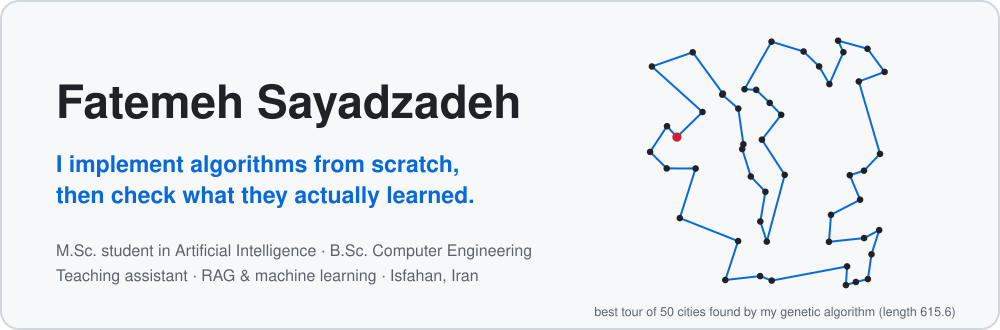
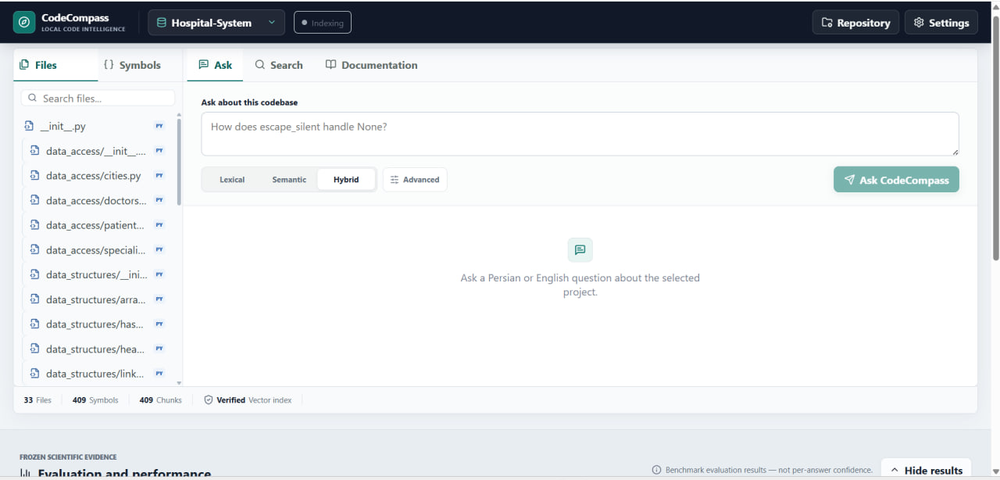

  <picture>
    <source media="(prefers-color-scheme: dark)" srcset="assets/hero-dark.svg">
    
  </picture>

  
  

## About

I hold a B.Sc. in computer engineering from the University of Isfahan and I'm now an **M.Sc. student in Artificial Intelligence at Isfahan University of Technology**. I like to build an algorithm myself first — a neural network, a genetic algorithm, a retrieval pipeline — and then measure what it actually learned, including where it falls short. I have also spent several semesters teaching the courses I took.

- 🧠 Interested in machine learning, retrieval-augmented generation and data-driven systems
- 💻 Experienced in full-stack and back-end development (React, Vue.js, Django, .NET)
- 👩‍🏫 Teaching assistant for many core CS courses (see [below](#-teaching))
- 📍 Isfahan, Iran

## 🎓 Bachelor's thesis

### [CodeQAPass](https://github.com/Ftm-Sayadzadeh/CodeQAPass) — a question-driven RAG system for understanding Python codebases

Ask a question about a Python repository in **Persian or English** and get a grounded answer with **verified citations** to the exact file, symbol and line range. Python's AST extracts the code structure, SQLite holds the metadata, ChromaDB the vectors, and a hybrid of lexical and semantic retrieval feeds an LLM. The LLM writes the explanation; the citations always come from the stored metadata, never from the model.

- **94.4 %** Top-3 retrieval with semantic search (Gemini Embedding 2) on 36 search queries, and **71 of 72** usable question-answering outputs in the final evaluation
- Compared embedding and language models (cloud and local) and context strategies on three real repositories, and reported missing runs as unavailable rather than scoring them zero
- `Python` · `SQLite` · `ChromaDB` · `LLM APIs and local models`

[Repository](https://github.com/Ftm-Sayadzadeh/CodeQAPass) · [Thesis report (PDF)](https://github.com/Ftm-Sayadzadeh/CodeQAPass/blob/main/docs/Fatemeh_Sayadzadeh_CodeCompass_Final_Report.pdf)

## 💼 Software engineering and internships

<table>
  <tr>
    <td width="50%" valign="top">
      <h4><a href="https://github.com/Ftm-Sayadzadeh/Gateway-Hub">Gateway Hub</a></h4>
      
<em>Internship project, 2025</em>

      
A real-time gateway management and monitoring platform with live log streaming and system metrics: a Vue 3 front end on top of a Django, GraphQL and WebSocket back end.

      
<code>Vue 3</code> <code>Django</code> <code>GraphQL</code> <code>WebSockets</code>

    </td>
    <td width="50%" valign="top">
      <h4><a href="https://github.com/Ftm-Sayadzadeh/UCMS">UCMS</a></h4>
      
<em>Software Engineering course, team final project</em>

      
A full-stack university platform for managing classes, assignments and student performance, with the UI/UX designed in Figma and a React front end.

      
<code>React</code> <code>Figma</code> <code>Team project</code>

    </td>
  </tr>
  <tr>
    <td width="50%" valign="top">
      <h4>Star Academy internship</h4>
      
<em>Summer 2024</em>

      
<a href="https://github.com/Ftm-Sayadzadeh/Full-Text-Search">Full-Text-Search</a>: a full-text search engine built on an inverted index, written test-first in pairs. <a href="https://github.com/Ftm-Sayadzadeh/Link-Analysis">Link-Analysis</a>: a graph-based API for modelling entities and analysing their relationships.

      
<code>C#</code> <code>.NET</code> <code>TDD</code> <code>Pair programming</code>

    </td>
    <td width="50%" valign="top">
      <h4><a href="https://github.com/Ftm-Sayadzadeh/health-ai-app">Health AI App</a></h4>
      
<em>Personal project, in progress</em>

      
A Persian-first, AI-assisted health and nutrition product. So far the foundation milestone: a Django REST API with phone-OTP and JWT authentication, a Next.js web skeleton, PostgreSQL, and Redis with Celery workers.

      
<code>Django REST</code> <code>Next.js</code> <code>TypeScript</code> <code>PostgreSQL</code> <code>Redis</code>

    </td>
  </tr>
</table>

## 📈 My learning curve

  <picture>
    <source media="(prefers-color-scheme: dark)" srcset="assets/curve-dark.svg">
    
  </picture>

## 📚 Coursework

Every course project is in a repository of its own:

| Course | Repositories |
|---|---|
| **Machine Learning** | [BSc-Machine-Learning-Assignments](https://github.com/Ftm-Sayadzadeh/BSc-Machine-Learning-Assignments) |
| **Deep Learning** | [BSc-Deep-Learning-Assignments](https://github.com/Ftm-Sayadzadeh/BSc-Deep-Learning-Assignments) |
| **Computational Intelligence** | [BSc-Computational-Intelligence-Assignments](https://github.com/Ftm-Sayadzadeh/BSc-Computational-Intelligence-Assignments) |
| **AI Fundamentals and Applications** | [AI_Fundamentals](https://github.com/Ftm-Sayadzadeh/AI_Fundamentals) |
| **Internet of Things** | [IOT-SmartHome](https://github.com/Ftm-Sayadzadeh/IOT-SmartHome) |
| **Data Structures** | [DataBase-BPTree](https://github.com/Ftm-Sayadzadeh/DataBase-BPTree) · [Search-Engine](https://github.com/Ftm-Sayadzadeh/Search-Engine) · [LinkedIn-Graph](https://github.com/Ftm-Sayadzadeh/LinkedIn-Graph) · [Calculator](https://github.com/Ftm-Sayadzadeh/Calculator) |
| **Advanced Programming** | [Online-Shop](https://github.com/Ftm-Sayadzadeh/Online-Shop) · [Clash-Of-Clans](https://github.com/Ftm-Sayadzadeh/Clash-Of-Clans) · [Chatroom](https://github.com/Ftm-Sayadzadeh/Chatroom) |
| **Programming Basics** | [Library-System](https://github.com/Ftm-Sayadzadeh/Library-System) |
| **Software Engineering** | [UCMS](https://github.com/Ftm-Sayadzadeh/UCMS) |
| **Self-study** | [RolePlayGame](https://github.com/Ftm-Sayadzadeh/RolePlayGame) (C#) |

## 🍎 Teaching

Teaching assistant at the University of Isfahan for **AI Fundamentals and Applications**, **Data Mining**, **Database Design Principles**, **Operating Systems**, **Formal Languages and Automata Theory**, **Data Structures**, **Systems Analysis and Design**, **Advanced Programming** and **Programming Basics**. I was also **Co-Head of Data Structures**, leading the exercises section and designing practice problems and assignments with the teaching team.

## 🛠️ Tech stack

   
  

## 🐍 Contribution snake

  <picture>
    <source media="(prefers-color-scheme: dark)" srcset="https://raw.githubusercontent.com/Ftm-Sayadzadeh/Ftm-Sayadzadeh/output/github-snake-dark.svg">
    
  </picture>

## 🌐 Contact

  
  

